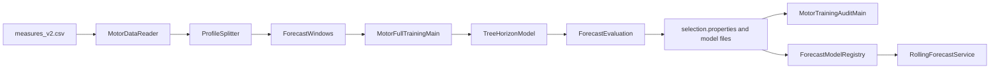

# Java Files and Responsibilities

The motor module currently contains 42 production Java files, including 8 in `legacy`, and 4 test files. The tables below describe each class's role in the current implementation. The main source directory is `src/main/java/ml/motor/`.

`MotorPredictMain.java` is the direct entry point for the published models. It reads a 61-reading JSONL history, loads the model bundle, and outputs forecasts for all five horizons. By default, it uses the small example included in the repository. From `training/`, run `./scripts/run-java.sh ml.motor.MotorPredictMain`.

## Training and Analysis Entry Points

| File | Purpose and inputs or outputs |
|---|---|
| `MotorFullTrainingMain.java` | Current GBDT training entry point using all valid training windows. Reads the CSV and previous experiment directory, verifies the dataset hash, Profile split and validation origins, and trains models for 1/5/10/30/60 seconds with seeds 42 and 2026. Writes new models, metrics, the model selection manifest, and save/reload checks. |
| `MotorHorizonExperimentMain.java` | Original multi-horizon GRU/GBDT comparison entry point. Handles training configuration, candidate comparisons, validation-based model selection and the one-time test evaluation entry point. Also provides experiment metadata and window-manifest file utilities reused by the full-training runner. |
| `MotorTrainingAuditMain.java` | Audits completed training. Measures coverage of original data rows, reloads the five selected models and checks their validation results, and generates training/validation curves by boosting stage and model checksums. |
| `ForecastDiagnosticsMain.java` | Analyzes prediction errors using paired bootstrap sampling over validation Profiles, compares models with Persistence, and examines the relationship between future load changes and errors. Future operating conditions are used only for post-hoc analysis. Writes `persistence_bootstrap.csv` and `validation_regimes.csv`. |

## Data, Time Windows and Features

| File | Responsibility |
|---|---|
| `MotorReading.java` | Stores one motor reading, its Profile ID and original sample index, and provides anomaly-detection features. |
| `MotorDataReader.java` | Reads the dataset with Commons CSV, groups records by Profile and downsamples by stride while preserving the original 2 Hz indices. |
| `ProfileSplitter.java` | Splits complete Profiles into training, validation and testing sets. For 69 Profiles and seed 42, the split is 48/10/11. |
| `ForecastWindows.java` | Builds 61-reading historical input windows and future-horizon targets, checking continuity, finite values and Profile boundaries. Full training separately enumerates the two 1 Hz sequences formed from even and odd original indices. |
| `MotorForecastV2.java` | Extracts 30 features covering historical temperature, temperature rise rates, load, current and power proxies. Also supports inference with the historical GBDT V2 model. The current GBDT reuses these 30 features as the first part of its 33-feature input. |
| `MotorGruFeatures.java` | Generates 13 features in a fixed order for each historical time step. GRU training and inference share this implementation. |

## Models and Shared Evaluation

| File | Responsibility |
|---|---|
| `HorizonForecaster.java` | Common interface for a single forecast horizon. Accepts historical readings and returns a temperature prediction in degrees Celsius. |
| `TreeHorizonModel.java` | Implements Smile GBDT training and inference, extends the feature vector to 33 dimensions, saves and loads individual models, and produces predictions by boosting stage for diagnostics. |
| `GruHorizonModel.java` | Implements the DJL GRU network, training loop, early stopping, batch predictions, model saving/loading and consistency checks. |
| `ForecastNormalizer.java` | Computes GRU input and target normalization parameters from training windows only. Saves and loads those parameters and converts predicted temperature deltas back to their original scale. |
| `BaselineForecaster.java` | Provides Persistence and historical-trend extrapolation baselines to measure whether a trained model adds value. |
| `ForecastModelRegistry.java` | Loads the selected model for each horizon from `selection.properties` and reports missing models or loading failures. |
| `ForecastEvaluation.java` | Computes MAE, MSE, RMSE, the 95th percentile absolute error, the fraction within ±0.2°C, high-temperature errors and per-Profile metrics. Produces CSV reports and PNG charts. |

## Rolling Forecast Interfaces for Team Integration

| File | Responsibility |
|---|---|
| `RollingForecastService.java` | Maintains a 61-reading history for each machine. Handles warmup, duplicates, gaps, Profile changes and invalid input; calls cached models; and combines current thermal status, predictive warnings and anomaly results. |
| `ForecastTelemetry.java` | Parses sensor JSON fields, machine IDs, timestamps and sample indices, with support for the team's existing field names. |
| `ForecastEnvelope.java` | Defines the Dashboard output structure, including measured temperature, predictions by horizon, target timestamps, statuses and inference latency. |
| `MotorForecastMqttMain.java` | MQTT process entry point. Subscribes to `sensors/+/telemetry`, publishes to `forecasts/<machineId>`, and loads models at startup. |
| `MotorForecastReplayMain.java` | Replays data from validation Profiles over MQTT for team integration checks. |
| `MotorForecastE2EMain.java` | MQTT integration verification tool. Checks machine-specific histories, warmup, rolling target timestamps and invalid input. Requires a running broker and forecast service. |

These classes provide the model delivery interfaces. The team's `simulator/` produces sensor data, `detection-alert/` handles existing detection and alerts, and `dashboard/` handles display. The inference interfaces are used by the current tests, MQTT entry point and team integration tools.

## Anomaly Detection and Legacy API Compatibility

| File | Retained purpose |
|---|---|
| `MotorIsolationForestTrainer.java` | Trains Isolation Forest and estimates its anomaly threshold. Called by the historical `legacy.MotorMain` entry point. |
| `MotorModelStore.java` | Loads the original Random Forest (RF), Isolation Forest and threshold configuration. The current MQTT service still uses it to obtain the anomaly model. |
| `CurrentThermalDetector.java` | Determines thermal status from the current temperature, configured thresholds and temperature rise rate. Still used by the rolling service. |
| `DetectionConfig.java` | Stores current/future temperature thresholds, the rise-rate threshold and the anomaly threshold for both the new and original services. |
| `MotorSensorMessage.java` | Original sensor message structure and conversion to `MotorReading`. Still reused by the current JSON parser. |
| `DetectionResult.java` | Result object for the original detection interface. |
| `MotorDetectionFacade.java` | Exposes the original RF/anomaly-detection interface and initializes its models and service. |
| `UnifiedDetectionService.java` | Combines the original RF 60-second forecast with thermal status and anomaly detection. |
| `ForecastDatasetBuilder.java` | Builds features and samples for the original RF model. Loading the original model metadata still checks these feature names. |
| `TemperatureForecastTrainer.java` | Trains the original RF model and provides the prediction method used by `UnifiedDetectionService`. |

## Historical Experiments

The following files are in `src/main/java/ml/motor/legacy/`, all under the `ml.motor.legacy` package. Their model algorithms and parameters are retained. Command-line invocations and IntelliJ Run Configurations must use the updated package name.

| File | Purpose | Original output location |
|---|---|---|
| `MotorMain.java` | Original RF and Isolation Forest training, evaluation and saving demonstration | `models/` |
| `MotorInferenceMain.java` | Loads the original RF/Isolation Forest models and uses synthetic messages to check inference and history resets | Reads the directory specified by the argument; defaults to `models/` |
| `MotorForecastV2Main.java` | Original single-horizon 60-second GBDT V2 experiment | `models_v2/` |
| `MotorGruTrainMain.java` | Original single-horizon 60-second GRU V4 experiment | `models_gru_v4/` |
| `MotorLearningCurveMain.java` | Original RF training-size and error curves | `results/learning_curve.csv/png` |
| `MotorAnomalyEvaluator.java` | Original Isolation Forest error/anomaly distribution evaluation | Console |
| `TemperatureModelEvaluator.java` | Original RF temperature-error evaluation | Console |
| `EarlyWarningEvaluator.java` | Original overheating early-warning evaluation | Console |

## Tests, Configuration and Scripts

| File | Responsibility |
|---|---|
| `src/test/java/ml/motor/ForecastPipelineTest.java` | Covers feature order, causal windows, targets, Profile isolation, normalization, rolling histories, JSON, invalid values and GRU save/reload behavior: 18 test cases. |
| `src/test/java/ml/motor/FullTrainingWindowsTest.java` | Covers window enumeration across both 1 Hz phases, continuity, reproducibility and GBDT predictions by boosting stage: 5 test cases. |
| `src/test/java/ml/motor/ForecastDiagnosticsTest.java` | Checks that post-hoc Persistence diagnostics do not overwrite the existing full-training comparison report. |
| `src/test/java/ml/motor/PublishedModelsTest.java` | Checks hashes for the five published models, their metadata and the selection manifest, and verifies that example outputs match those from the original local models. |
| `pom.xml` | Configures Java 17 compilation and the Smile, DJL, CSV, charting, MQTT, JSON and JUnit dependencies. Each dependency has a current use in the module. |
| `scripts/mvn.sh` | Selects the local Java 17 and Maven installations. |
| `scripts/run-java.sh` | Compiles the module, builds the dependency classpath and launches the specified Java main class. |
| `scripts/add-forecast-user.sh` | Helps configure the forecast user for the team's broker. |
| `integration/forecast.properties` | Configures model directories, broker address, thresholds, machine cache capacity and timestamp tolerance. |
| `integration/forecast-flow.json` | Node-RED Dashboard template for receiving MQTT forecasts. |
| `integration/forecast-acl.conf` | Example MQTT topic permissions for the forecast service. |

## Training Data Flow

